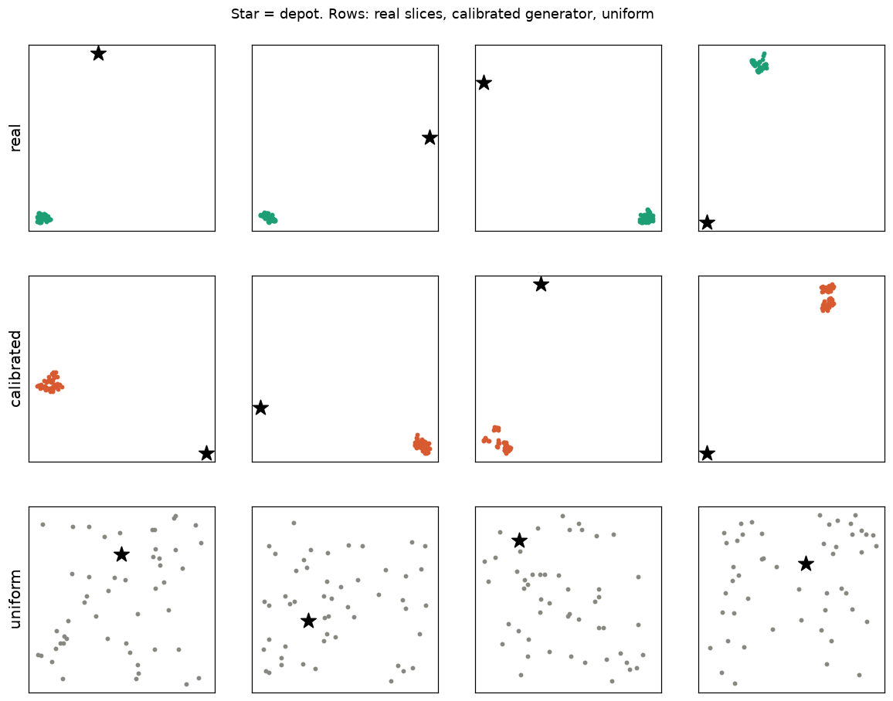
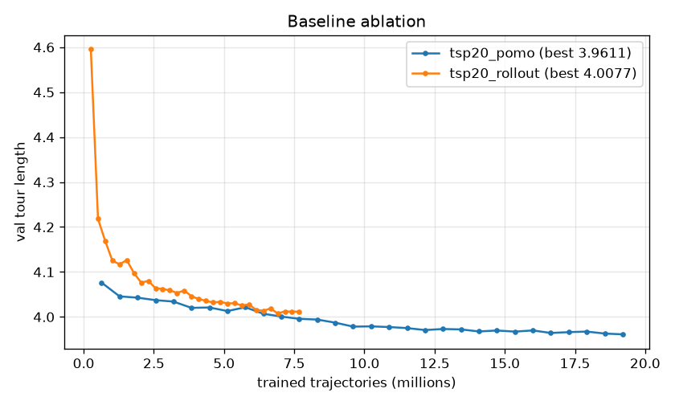
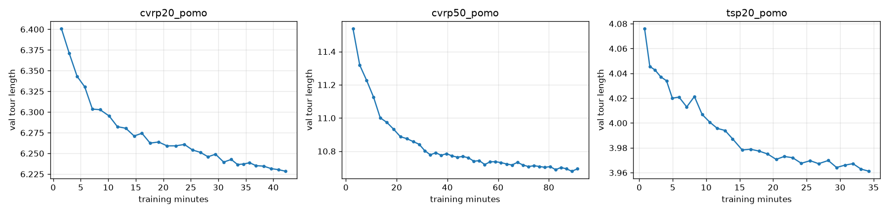

# Neural Last-Mile Routing

Deep reinforcement learning solvers for vehicle routing with capacities and time windows (CVRPTW),
benchmarked against OR-Tools, PyVRP and **real delivery drivers** on ~9,000 Amazon last-mile routes.

> **The case.** *Ruta Norte Logistics* (fictional) runs last-mile delivery vans out of several
> stations. Its historical operations are the public
> [Amazon Last Mile Routing Research Challenge](https://registry.opendata.aws/amazon-last-mile-challenges/)
> dataset: real stops, packages, time windows, travel-time matrices and the sequence each driver
> actually drove. Three questions drive the project:
>
> 1. Can we sequence each van's stops better than its driver did?
> 2. How many vans and hours do we save by re-assigning a station's whole day from scratch?
> 3. Can we re-plan in milliseconds when an urgent order arrives or a van breaks down?

## Status

| Phase | Scope | State |
|---|---|---|
| 0 | Repo, tooling, CI, data model, ETL, EDA | ✅ |
| 1 | Baselines (NN, Clarke-Wright, OR-Tools, PyVRP) + evaluator + benchmark | ✅ |
| 2 | Attention Model + POMO (REINFORCE) on TSP/CVRP, neural solver, synthetic benchmark | ✅ |
| 3 | Calibrated generator, customer-centric normalisation, time windows, local search, size curriculum, real-route evaluation | ✅ |
| 4 | Real asymmetric travel times (MatNet-style), fine-tuning, ONNX | |
| 5–7 | FastAPI + OSRM backend, Next.js/deck.gl frontend, deployment | |

## Headline: 200 unseen real Amazon routes

Evaluation split (routes never seen by the generator or any model), ~150 stops each, real
asymmetric travel-time matrices and real time windows. The *controllable* gap excludes the
unavoidable station round trip (~75 % of every route); see ADR-012.

| Solver | Hours / route | Gap | Controllable gap | Late stops | Runtime |
|---|---|---|---|---|---|
| PyVRP (10 s) | 2.90 | 0.25 % | 0.36 % | 0 % | 10 s |
| **Attention (Amazon, 100) + local search** | **2.98** | **2.91 %** | **4.32 %** | 0.07 % | **0.9 s** |
| OR-Tools (10 s) | 2.99 | 3.28 % | 4.98 % | 0 % | 10 s |
| Savings + local search | 3.01 | 4.14 % | 6.51 % | 0.44 % | 0.01 s |
| **Real driver** | 3.28 | 13.96 % | 22.2 % | 0.09 % | — |
| Attention (Amazon, 150) without local search | 3.61 | 24.73 % | 37.93 % | 0.25 % | 0.8 s |

* The hybrid cuts **9 % of driving time against the real drivers** (3.28 h → 2.98 h per route) and
  beats OR-Tools given 10 s in under a second.
* On real roads **the network alone is weak** (38 % controllable gap vs ~3.6 % on synthetic
  Amazon-like data): it reasons on straight-line geometry while real streets are asymmetric and
  indirect, and local search on the real matrix recovers most of the gap. Feeding the real matrix
  to the encoder is the goal of phase 4.
* Size curriculum (50 → 100 → 150, ADR-016): the 100-stop model is best (4.32 %); the 150 stage
  did not improve on it. Real time windows are never a problem (≤ 0.13 % late stops).

Full table with every model: [`results/route_evaluation_n200_final.md`](results/route_evaluation_n200_final.md).

**Whole station-days** (6 real days, ~5 vans each; ADR-020): clustering the day into vans and
routing each with the matrix-aware network gives **13.43 fleet hours per day vs 15.34 for the real
drivers (−12.5 %)** and 14.26 for PyVRP given 60 s, in 2 s per day.

## Baseline results

See [`results/`](results/) for the generated tables. Gap is relative to the best solution found
for each instance; every solver is scored by the same evaluator (`core/evaluate.py`).

<!-- results:start -->
### 1 · Re-sequencing real routes (200 Amazon routes, ~150 stops each)

| Solver | Driving time / route | vs. best | Runtime |
|---|---|---|---|
| PyVRP (10 s) | **3.11 h** | +0.05 % | 10 s |
| PyVRP (1 s) | 3.13 h | +0.9 % | 1 s |
| OR-Tools (10 s) | 3.21 h | +3.3 % | 10 s |
| Clarke-Wright savings | 3.43 h | +10.9 % | 10 ms |
| **Real driver** | 3.51 h | +13.9 % | — |
| Nearest neighbour | 3.59 h | +15.8 % | <1 ms |

Optimising the stop order alone cuts **~11 % of driving time** per van with the same stops and
almost no late arrivals. Drivers trade some distance for zone-by-zone delivery (see the EDA), so
part of the gap is a human preference the optimiser does not yet model.

### 2 · Re-assigning whole station-days (6 days, ≤1,200 stops, same fleet)

| Solver | Driving time / day | vs. best | Runtime |
|---|---|---|---|
| PyVRP (60 s) | **14.3 h** | +7.2 % | 60 s |
| Clarke-Wright savings | 14.9 h | +10.4 % | 40 ms |
| **Real drivers** | 15.3 h | +14.7 % | — |
| OR-Tools (60 s) | 18.0 h | +20.1 % | 60 s |

Pooling a station's day and re-assigning stops saves **~7 % of fleet hours**. OR-Tools does not
converge on 1,000+ stops in 60 s. Cross-route travel times are estimated (ADR-005), so treat this
as indicative; 6 days is a small sample.

### 3 · Neural solver vs classic (200 unseen synthetic instances)

| Solver | TSP-20 gap | CVRP-20 gap | Runtime |
|---|---|---|---|
| PyVRP (5 s) | 0 % | 0.16 % | 5 s |
| OR-Tools (1 s) | 0 % | 1.79 % (4 failures) | 1 s |
| **Attention + POMO (×8 aug.)** | **0.23 %** | **0.67 %** | **80 ms** |
| Attention, single greedy rollout | 6.7 % | 5.9 % | 60 ms |
| Clarke-Wright savings | 7.2 % | 4.5 % | <10 ms |
| Nearest neighbour | 17.0 % | 31.2 % | <1 ms |

After ~35 minutes of training per problem on a GTX 1660 Super, the policy is within 1 % of
PyVRP at 12–60× lower latency and beats OR-Tools on CVRP-20. Single greedy decoding is weak because
POMO training always forces the first customer; multi-start decoding is the intended mode.

**CVRP-50** (200 instances; model trained 60 epochs, best at 52, ~2.3 h; early stopping):

| Solver | Gap | Runtime |
|---|---|---|
| PyVRP (10 s) | 0.02 % | 10 s |
| **Attention + POMO (×8 aug.)** | **1.81 %** (2.0 % at epoch 38) | **190–270 ms** |
| OR-Tools (10 s) | 3.2–4.0 % (2 failures) | 10 s |
| Clarke-Wright savings | 5.1 % | <10 ms |
| OR-Tools (1 s) | 6.5 % (3 failures) | 1 s |
| Attention, CVRP-20 model (size transfer) | 4.2 % | 210 ms |

The network beats OR-Tools given ~40× more time. OR-Tools' gap depends on how many benchmark
workers share the CPU (3.2 % with 3, 4.0 % with 6), the network's does not. Training past epoch 40
gave only 0.28 % on validation, so further gains will come from local search and curriculum, not
more epochs at this size. **Size generalisation** is the weak spot: the
CVRP-20 model drops to 4.2 % on CVRP-50, which is why the plan trains at the target size and adds
a size curriculum in phase 3 (real routes have ~150 stops).

**Hybrid: network + local search** (2-opt / or-opt / swap on the 8 best decoded candidates;
same 200 instances per problem):

| Solver | TSP-20 | CVRP-20 | CVRP-50 | Runtime (CVRP-50) |
|---|---|---|---|---|
| PyVRP (5–10 s) | 0 % | 0.16 % | 0.05 % | 10 s |
| **Attention + POMO + local search** | **0.01 %** | **0.19 %** | **0.62 %** | **230 ms** |
| Attention + POMO | 0.23 % | 0.67 % | 1.84 % | 220 ms |
| Savings + local search | 0.53 % | 2.87 % | 3.58 % | <10 ms |
| Savings | 7.15 % | 4.49 % | 5.11 % | <10 ms |

**CVRP-100** (100 instances; model trained 56 epochs, ~3.5 h on the GTX 1660 Super):

| Solver | Gap | Runtime |
|---|---|---|
| PyVRP (20 s) | 0 % | 20 s |
| **Attention + POMO + local search** | **1.34 %** | **0.66 s** |
| Attention + POMO | 3.53 % | 0.65 s |
| Savings + local search | 3.91 % | 10 ms |
| OR-Tools (20 s) | 6.41 % (6 failures) | 20 s |

The hybrid's gap grows with size (0.19 % → 0.62 % → 1.34 % for 20/50/100 customers) but it still
beats OR-Tools by ~5 points at 1/30 of its runtime.

Local search cuts the network's gap by about 3× for ~10 ms. The same search on top of savings
stays far behind, so the gain comes from the network's starting points, not from the search
alone: on CVRP-50 the hybrid is within 0.6 % of PyVRP at 1/40 of its runtime. Implementation
notes in ADR-010.

**Calibrated generator.** Training data so far was uniform. A generator fitted on all 6,112 real
routes (ADR-011, `notebooks/02_generator.ipynb`) reproduces real route slices: far station,
clustered stops, real loads and time windows.

| Normalised statistic (50 customers) | Real | Calibrated | Uniform |
|---|---|---|---|
| Depot to customer centroid | 1.02 | 1.01 | 0.40 |
| Customer spread | 0.031 | 0.036 | 0.377 |
| Nearest-neighbour distance | 0.006 | 0.006 | 0.076 |
| Load / van capacity | 0.24 | 0.25 | 6.3 |



**Training on realistic data is what matters** (CVRP-50, 200 Amazon-like instances; gap on the
controllable part of the tour, i.e. excluding the unavoidable ~78 % depot round trip; ADR-012):

| Model | Gap | + local search |
|---|---|---|
| Trained on calibrated data (customer-centric normalisation) | **3.56 %** | **0.37 %** |
| Trained on calibrated data (depot-inclusive normalisation) | 3.68 % | 0.34 % |
| Trained on uniform data | 34.87 % | — |
| Savings | 14.96 % | — |

The uniform-trained model, within 1.8 % of PyVRP on uniform data, is worse than savings on
realistic instances; the same architecture trained on the calibrated generator is 10x better.
The two normalisations tie at 50 stops; the customer-centric one is kept for larger instances.

**Baseline ablation (TSP-20, same 200 instances, same inference code).**

| Training | Multi-start ×8 aug. | Single greedy | Params | Trained trajectories | Hardware |
|---|---|---|---|---|---|
| POMO shared baseline (Kwon 2020), 6 layers, InstanceNorm | **0.23 %** | 6.71 % | 1.30 M | 19.2 M | GTX 1660 S, 35 min |
| Greedy-rollout baseline (Kool 2019), 3 layers, BatchNorm | 0.34 % | **2.10 %** | 0.71 M | 7.7 M | Colab T4, 40 min |

Each method wins at what it trains for: POMO always forces the first customer, so it is best when
all N starts are decoded and poor at a single rollout; the rollout policy learns the first move
too and is 3× better in one shot. Per trained trajectory the curves are close (below); the
comparison also differs in architecture, so it is indicative rather than a clean single-factor
ablation. For the real-time re-planner, decode with POMO multi-start (~60 ms).





Full tables: [`results/`](results/).
<!-- results:end -->

## Quick start

```bash
# 1. environment (Python 3.12 via uv)
uv sync

# 2. data: ~3.2 GB from the public S3 bucket, resumable
uv run python scripts/download_amazon.py --split all

# 3. JSON -> Parquet + memory-mapped matrices (~10 min for training)
uv run nr-etl --split all

# 4. benchmark
uv run nr-bench --mode route --n 200 --configs reference nearest_neighbor savings ortools:1 ortools:10 pyvrp:1 pyvrp:10
uv run nr-bench --mode station-day --n 5 --max-stops 1500 --configs reference savings ortools:60 pyvrp:60

# 5a. use the published models...
uv run python scripts/download_models.py

# 5b. ...or train them (Hydra configs in configs/; resumes automatically)
uv run nr-train --config-name tsp20
uv run nr-train --config-name cvrp50 train.epochs=60
tensorboard --logdir runs

# 6. neural vs classic on the training distribution
uv run nr-bench-synth --problem cvrp --size 20 --configs savings ortools:1 pyvrp:5 attention

# tests, lint, types
uv run pytest && uv run ruff check . && uv run mypy
```

**HTTP API** (phase 5): `uv run nr-api`, then open http://127.0.0.1:8000/docs.

| Endpoint | Does |
|---|---|
| `GET /solvers`, `GET /models` | registered solvers; neural checkpoints available by name |
| `GET /instances?split=evaluation` | real routes (station, date, stops) |
| `GET /instances/{split}/{route_id}` | stops with coordinates, demand, service time, window, and the driver's order |
| `POST /solve` | one solver on one route → routes, `[lng, lat]` paths, metrics |
| `POST /compare` | several solvers on one route, with gaps vs the best |

Neural solvers take `"model": "cvrp100_pomo_amazon"`, a checkpoint *name* (never a path).

**VS Code:** open the folder and accept the recommended extensions; `.vscode/` selects the `.venv`
interpreter and adds tasks (`Ctrl+Shift+P` → *Tasks: Run Task*: train, benchmark, TensorBoard, GPU
monitor, checks) and debug configurations (`F5`).

**No local GPU?** Train any config on a free Colab T4 (checkpoints on Google Drive, auto-resume):
[](https://colab.research.google.com/github/Marcofer14/GraphProject/blob/main/notebooks/colab_train.ipynb)

Long jobs (training + benchmarks) can run as detached chains that survive closing the terminal,
logging to `logs/chain_<X>.log`; see [`scripts/jobs.ps1`](scripts/jobs.ps1):

```powershell
powershell -File scripts/start_jobs.ps1 A B C
```

Use any solver from Python:

```python
from neural_routing.core import evaluate
from neural_routing.data.amazon import AmazonDataset
from neural_routing.solvers import get_solver

ds = AmazonDataset("training")
inst = ds.route_instance(ds.routes.index[0])  # one van, real matrix, driver's sequence
for name in ["reference", "savings", "pyvrp"]:
    print(name, evaluate(inst, get_solver(name).solve(inst, time_limit=2)).travel_time_s)
```

## Layout

```
src/neural_routing/
  core/        VRPInstance, Solution, evaluate()  - the contract every solver follows
  data/        Amazon ETL, dataset loader (route + station-day views), synthetic instances
  solvers/     reference (driver), nearest neighbour, Clarke-Wright, OR-Tools, PyVRP, attention
  ml/          GPU routing env (TSP/CVRP), attention policy, REINFORCE trainer (POMO / rollout)
  eval/        Amazon and synthetic benchmark CLIs
configs/       Hydra training configs (tsp20, cvrp20, cvrp50, tsp20_rollout)
scripts/       dataset download
notebooks/     01_eda.ipynb
docs/          decisions.md (architecture decision records)
results/       benchmark tables
tests/
```

Design decisions and their trade-offs are recorded in [`docs/decisions.md`](docs/decisions.md).

## Data license

The Amazon Last Mile Routing Research Challenge data is © Amazon.com, Inc., released under
[CC BY-NC 4.0](https://creativecommons.org/licenses/by-nc/4.0/). It is downloaded at setup time and
never committed. *Ruta Norte Logistics* is fictional and unaffiliated with Amazon.
