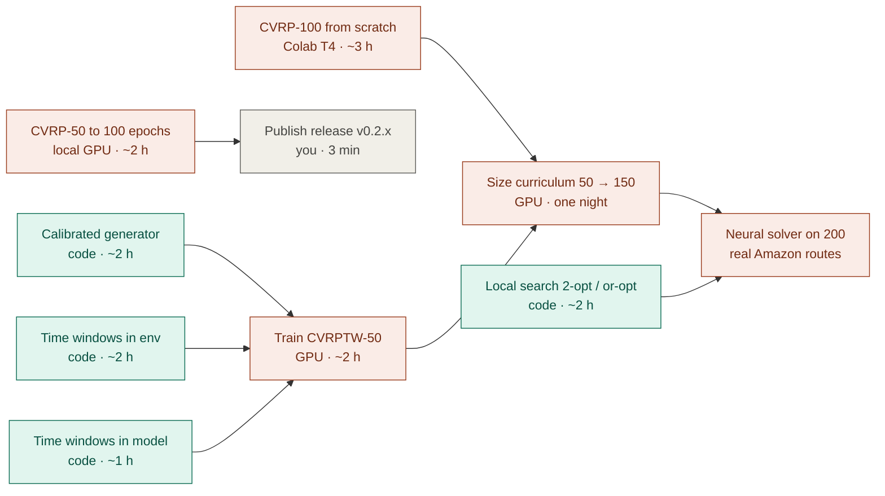

# Roadmap · phase 3 (weeks 5–6)

Long jobs (GPU / wall-clock) start first so the GPUs are never idle while code is written.

| Item | Blocked by | Unblocks | Runs on |
|---|---|---|---|
| CVRP-50 → 100 epochs | nothing (resumes from checkpoint) | better release weights | local GPU (chain `D`) |
| CVRP-100 | nothing | warm start for the curriculum | Colab T4 (`configs/cvrp100.yaml`) |
| Local search ✅ (CVRP-50 gap 1.84 % → 0.62 %) | nothing | +quality for every neural model | CPU |
| Calibrated generator ✅ (matches real slices, notebook 02) | nothing | realistic training data | CPU |
| Customer-centric normalisation ✅ (tie with old one at 50 stops; adopted, ADR-012) | — | training on the real distribution | done |
| Early stopping on controllable length ✅ (ADR-013) | — | fair stopping on Amazon-like data | done |
| Time windows ✅ (env + model + inference + benchmark, ADR-014) | — | CVRPTW training | done |
| Train CVRPTW-50 (`cvrptw50_amazon`) | — | curriculum with windows | GPU, ~2–3 h |
| Time windows (env + model) | nothing | CVRPTW training | CPU, then GPU tests |
| CVRPTW-50 | generator + time windows | curriculum with windows | GPU |
| CVRP-100 ✅ (1.34 % with local search; stopped at epoch 55) | — | warm start for the curriculum | done |
| Size curriculum | CVRPTW-50 (+ normalisation experiment) | real-size model | GPU, overnight |
| Amazon test | curriculum + local search | the headline number of phase 3 | GPU + CPU |
