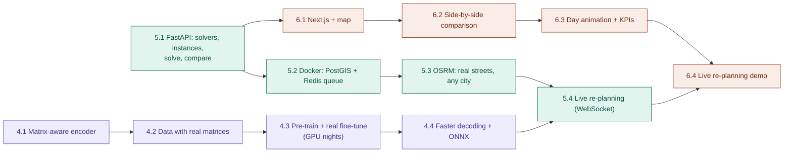

# Roadmap · phases 4–6

Two tracks run in parallel so neither the GPU nor development waits: the **ML track** (phase 4,
long GPU jobs) and the **product track** (phases 5–6, code).

**Status 2026-10-22:** phase 4 ✅ — matrix-aware model trained on real routes (network alone
38.1 % → 10.4 %, hybrid 4.33 % → 2.86 %, ADR-017), driver-similarity score (ADR-018), 2.5x faster
inference (ADR-019), whole-day fleet planning −12.5 % hours vs drivers (ADR-020) · 5.1 API ✅ ·
next: the demo (6.x) and deployment, then optional extras (5.2–5.4, continued training,
zone-aware imitation of drivers).

| Step | Needs | Delivers |
|---|---|---|
| 4.1 Matrix-aware encoder | — | policy that sees asymmetric travel times |
| 4.2 Data with matrices | 4.1 | real route slices with sub-matrices + calibrated synthetic asymmetry |
| 4.3 Train + fine-tune | 4.2, GPU | goal: network alone well below 38 % on real routes, hybrid towards 1–2 % |
| 4.4 Speed + ONNX | 4.3 | sub-second CPU inference for the live demo |
| 5.1 API | — | `/health`, `/solvers`, `/instances`, `/solve`, `/compare` |
| 5.2 Postgres/PostGIS + Redis | 5.1, Docker Desktop | stored runs, async jobs for slow solvers |
| 5.3 OSRM | 5.2 | travel-time matrices for any city |
| 5.4 Live re-planning | 5.3, 4.4 | WebSocket events: urgent order, broken-down van |
| 6.1 Next.js + MapLibre | 5.1, Node.js | routes on a map |
| 6.2 Comparison | 6.1 | network vs OR-Tools vs real driver, KPIs |
| 6.3 Animation + KPIs | 6.2 | deck.gl TripsLayer day replay |
| 6.4 Live demo | 6.3, 5.4 | click to add an order, re-plan in < 1 s |
